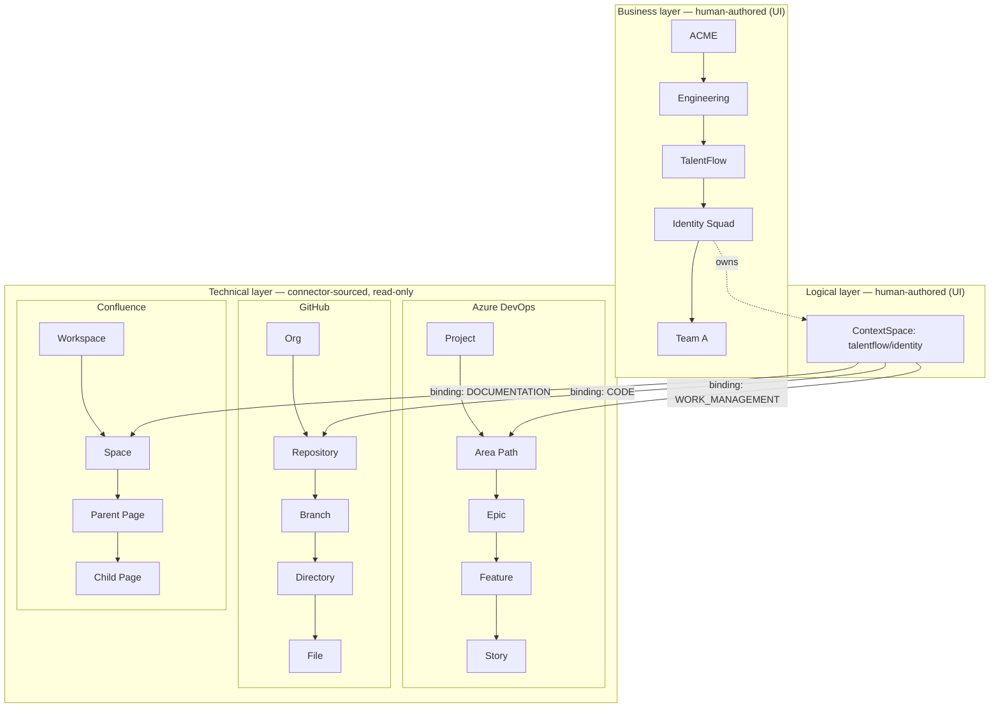
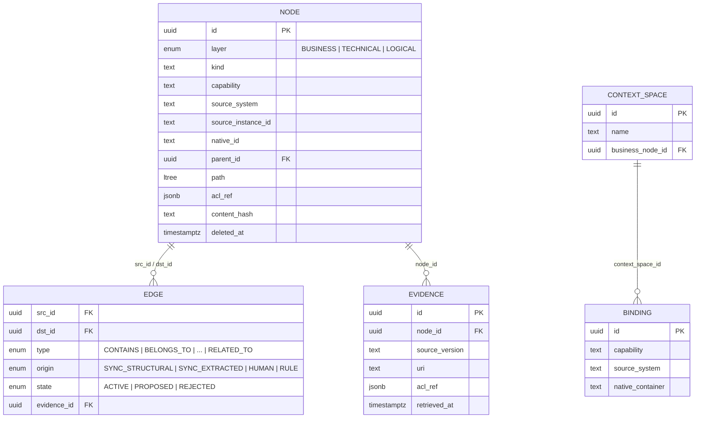
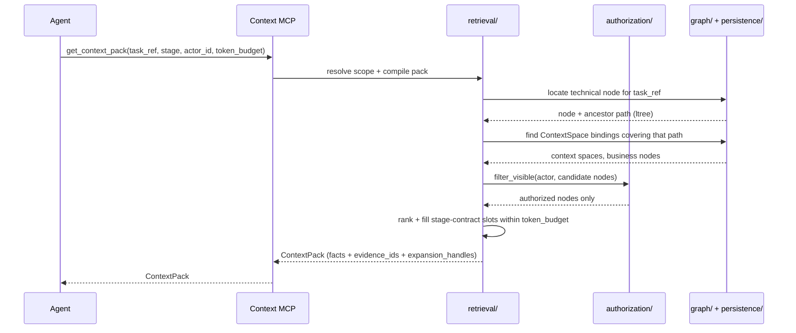
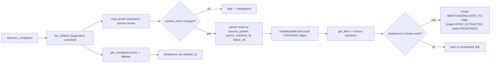

# Architecture

Context Fabric builds a context graph over three layers, keeps it in sync
with source systems, and serves it deterministically as search, MCP, and a
UI. This document is the design reference; `docs/phases/` turns it into an
ordered task list, and `AGENTS.md` states the rules that bind both.

## 1. The three layers

| Layer | Owned by | Mutable how | Contains |
|---|---|---|---|
| **Business** | Humans, via UI | CRUD in the UI (`docs/UI.md`) | Org → division → tribe → squad → team, products, services |
| **Technical** | Connectors, via sync | Never hand-edited — sync only | Each source's *native* hierarchy, exactly as that source models it |
| **Logical** | Humans, via UI | CRUD in the UI | `ContextSpace` + `Binding` rows that bind a business node to native technical containers, by capability |

The logical layer is what makes the other two useful together: a business
node alone doesn't know where its code lives, and a technical node alone
doesn't know which team owns it. A `ContextSpace` is the human decision that
connects them.

## 2. One graph, one storage engine (ADR-002)

All three layers live in one `node` table and one `edge` table in
PostgreSQL — see `docs/persistence.md` for the schema. `layer` on `node`
and `origin`/`state` on `edge` distinguish where a row came from and how
much to trust it; there is no separate graph database.

## 3. Request-time data flow

Authorization runs **before** ranking (ADR-007) — ranking and compilation
never see a node the actor cannot read.

## 4. Sync data flow

Running the same fixture data through this pipeline twice must produce zero
net graph change — the idempotency gate tested in
`docs/phases/PHASE-06.md`.

## 5. Actual lineage vs. structural containment

Two different relationship shapes coexist on the same edge table:

- **Structural containment** (`origin=SYNC_STRUCTURAL`): a source's native
  hierarchy — Project → Area Path → Epic → Story, or Org → Repo → Branch →
  Path → File. Always `CONTAINS`/`BELONGS_TO`.
- **Actual lineage** (`origin=SYNC_EXTRACTED` or `HUMAN`): the real delivery
  chain when links exist in the source data —
  `Requirement -> Design -> Pull Request -> Commit -> Build -> Test Result -> Deployment`,
  via `SPECIFIED_BY`, `IMPLEMENTS`, `CHANGES`, `VERIFIES`, `DEPENDS_ON`.

Lineage edges are only created where evidence exists (a link, a mention, a
human-drawn binding) — never inferred by guessing.

## 6. Components

| Package | Responsibility | Depends on |
|---|---|---|
| `domain/` | Pydantic models, enums, errors. No I/O. | nothing in this repo |
| `persistence/` | SQLAlchemy models, repositories, session/engine | `domain/` |
| `connectors/` | `SourceConnector` implementations (fixture + live) | `domain/` |
| `synchronization/` | Orchestrates connectors → domain → persistence, idempotently | `domain/`, `persistence/`, `connectors/`, `graph/` |
| `catalog/` | Business layer + logical layer (`ContextSpace`/`Binding`) writes | `domain/`, `persistence/` |
| `graph/` | Traversal (recursive CTE, ltree) | `domain/`, `persistence/` |
| `authorization/` | `can_read` / `filter_visible`, applied before ranking | `domain/`, `persistence/` |
| `retrieval/` | Scope resolution, context-pack compiler, stage contracts | `domain/`, `persistence/`, `graph/`, `authorization/`, `catalog/` — never `connectors/` |
| `observability/` | structlog config, correlation IDs, redaction | leaf, depended on by all |
| `api/` | REST routes consumed by `ui/` | `retrieval/`, `catalog/`, `graph/`, `synchronization/`, `authorization/` |
| `mcp/` | The one Context MCP server, stdio + HTTP | `retrieval/`, `catalog/`, `authorization/` |
| `cli/` | `context-fabric` Typer app | `synchronization/`, `connectors/`, `retrieval/` |
| `ui/` | React SPA — business + logical layer authoring, read-only catalog/graph browsing | Context Fabric REST API only |

See `src/context_fabric/__init__.py` for the enforced dependency direction
and the two rules that matter most (retrieval never imports connectors;
connectors never leak vendor shapes).

## 7. Explicitly out of scope

Vector embeddings, semantic search, LLM-generated summaries, a dedicated
graph database, full Confluence/Jira/Notion/ClickUp connectors, full
repository AST parsing, a custom Graphify replacement, source-system
writes, autonomous inference of team ownership, full raw-content
replication, Kubernetes, premature microservices, complex event-bus
infrastructure. See `AGENTS.md` §4 for the authoritative, binding list and
ADR-001 for why.

## 8. Where to go next

- `docs/DOMAIN_MODEL.md` — every entity and field
- `docs/persistence.md` — the actual schema and indexes
- `docs/CONNECTORS.md` — the `SourceConnector` protocol
- `docs/RETRIEVAL.md` — scope resolution and the pack compiler
- `docs/MCP.md` — the four MCP tools
- `docs/API.md` / `docs/UI.md` — the REST surface and the UI that consumes it
- `docs/SECURITY.md` — authorization and secret handling
- `docs/adr/` — the decisions behind each of the above
